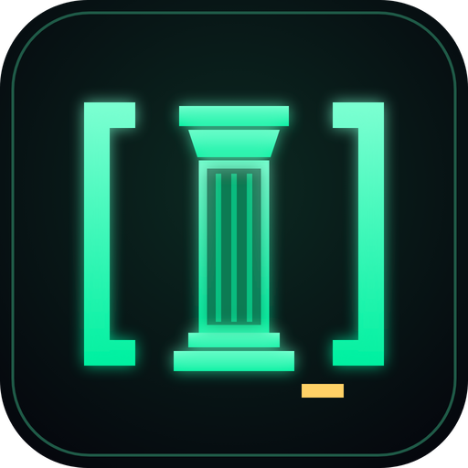
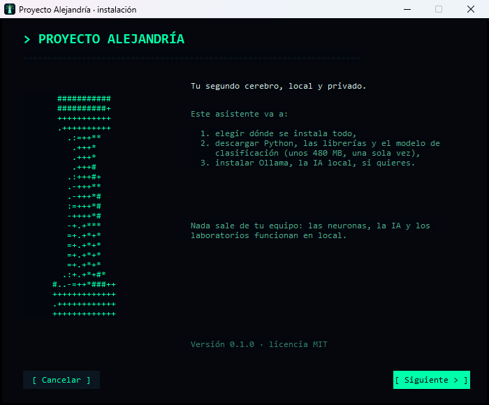
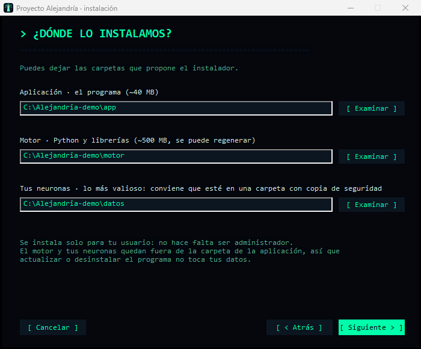
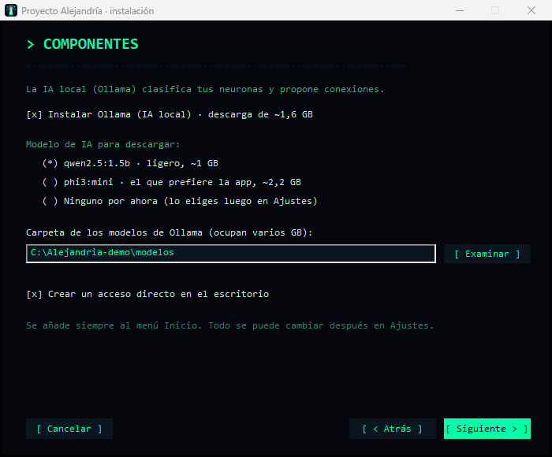
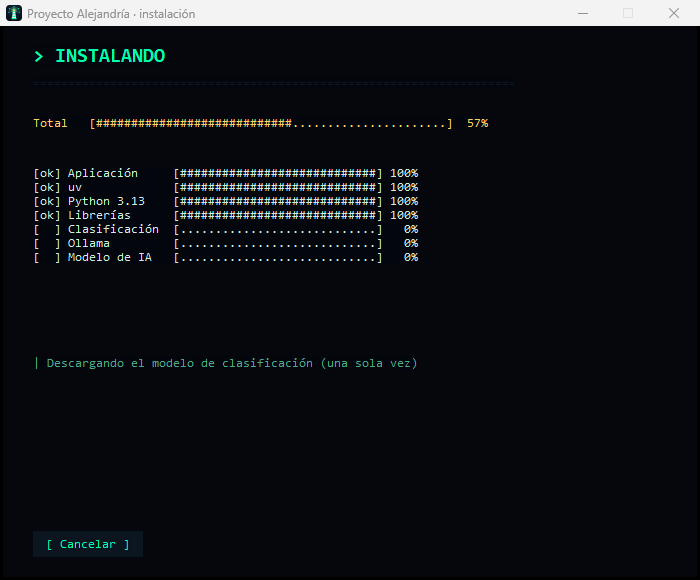

# Proyecto Alejandría

**Español** · [English](#english)

Tu segundo cerebro, local y privado. Cada concepto que aprendes es una **neurona** en un universo 3D; las **sinapsis** (conexiones) las propone una IA que corre en tu propio ordenador. Cada neurona trae teoría, glosario, ejercicios y un **laboratorio**: una simulación en Python que se ejecuta en la propia ventana (Pyodide/WebAssembly), sin internet y sin tocar tus archivos.

<p align="center"></p>

> **Estado: versión temprana (0.1).** Solo Windows 10/11.

## Instalar

1. Descarga `Proyecto-Alejandria-Setup.exe` de la página de [Releases](../../releases).
2. **Comprueba que no está alterado** (opcional, recomendable): en PowerShell, `Get-FileHash .\Proyecto-Alejandria-Setup.exe -Algorithm SHA256` debe dar el mismo valor que `SHA256SUMS.txt` de esa Release.
3. Ejecútalo. **Windows SmartScreen avisará** («Windows protegió su PC») porque el instalador **no está firmado** (la firma de código cuesta dinero y este es un proyecto personal). Pulsa *Más información → Ejecutar de todas formas*. Solo conviene hacerlo si lo has descargado de esta Release y el hash coincide.
4. El asistente te deja elegir dónde va la aplicación, el «motor» (Python y librerías, ~500 MB), tus neuronas y, si quieres, instalar **Ollama** (la IA local, 1,6 GB) con un modelo. Con *Examinar* eliges una carpeta y cada parte se guarda en su propia subcarpeta (`Aplicacion`, `Motor`, `Neuronas`, `Modelos`); la casilla «Instalarlo todo en una sola carpeta» lo hace de una vez para todas. Todo se descarga una sola vez; no hace falta ser administrador.

**Requisitos:** Windows 10 o 11 de 64 bits y el *Microsoft Visual C++ Redistributable* actual (versión 14.40 o posterior de `msvcp140.dll`; [descargas oficiales](https://learn.microsoft.com/cpp/windows/latest-supported-vc-redist)). Casi todos los equipos lo tienen, pero uno antiguo hace que el motor de IA se caiga al cargar; el instalador lo comprueba antes de descargar nada y te lo dice.

**Actualizaciones:** desde la 0.2.0 la app avisa al abrir cuando hay una versión nueva. Al pulsar [ Actualizar ] descarga el instalador, comprueba su firma digital con la clave pública que lleva dentro (solo se instala lo firmado por el proyecto), se cierra, se actualiza sola y se vuelve a abrir; tus neuronas no se tocan. Solo si una versión cambiara las carpetas que usa, te pregunta por las nuevas. Las versiones anteriores a la 0.2.0 se instalan a mano una vez.

**Si algo falla:** el registro está en `instalacion.log`, en la carpeta del motor (por defecto `%LOCALAPPDATA%\dev.alejandria.app\motor`), y el del servidor en `backend.log`. Un error con el código `-1073741819` (0xC0000005) casi siempre es un Visual C++ antiguo: repáralo en *Configuración → Aplicaciones → Microsoft Visual C++ v14 Redistributable → Modificar → Reparar* (o instala el actual) y reinicia. Si el instalador se detiene, vuelve a ejecutarlo: retoma lo que falte.

<p align="center">




</p>

## Qué hace

- **Neuronas**: pega el JSON que te devuelva tu IA favorita (hay dos prompts listos en el Inyector Neuronal; el de exploración le pide consultar Google Scholar) y la app lo clasifica en una rama y lo coloca en el universo.
- **Sinapsis**: una IA local (Ollama) propone conexiones con su razón; tú las aceptas o rechazas, y lo rechazado no se vuelve a proponer.
- **Laboratorios editables**: mueve los controles y el gráfico se redibuja al instante (barras, líneas, áreas, escala logarítmica...); puedes cambiar variables, rangos y código.
- **Tus datos son tuyos**: todo vive en una carpeta local; Ajustes permite exportar e importar neuronas, elegir el modelo de IA o desactivarla.
- **Tutorial** en la primera ejecución y 3 neuronas de ejemplo opcionales.

## Privacidad

Nada sale de tu equipo: la IA corre en local, el backend solo escucha en `127.0.0.1` y rechaza peticiones de otros orígenes, la app aplica una política de contenido (CSP) estricta y el código de los laboratorios se ejecuta aislado en WebAssembly y pide tu aprobación antes de correr. La única red que se usa es para descargar (una vez) uv, Python, las librerías, el modelo de clasificación y, si lo eliges, Ollama y su modelo. Además, al abrir, la app pregunta a github.com si hay una versión nueva (no envía nada tuyo); se puede apagar en Ajustes.

## Desarrollo

Necesitas [Python](https://www.python.org/) 3.11+ (probado con 3.13), [Node.js](https://nodejs.org/) 20+ y [Rust](https://rustup.rs/).

```bash
alejandria.bat                    # backend de desarrollo (crea el entorno la primera vez)
cd frontend && npm install && npm run tauri dev
```

La primera vez, `npm run dev`/`build` descarga Pyodide (~40 MB, comprobado con sha256) a `frontend/public/pyodide/`.

```bash
cd frontend && npm run instalador # compila la app y construye el instalador (frontend/installer/)
cd backend && .venv\Scripts\python.exe -m unittest test_backend
cd frontend && npm test && npx tsc --noEmit
```

El instalador se puede probar sin tocar tu sistema: `Proyecto-Alejandria-Setup.exe /PRUEBA=C:\carpeta` lo hace todo dentro de esa carpeta.

## Licencia

[MIT](LICENSE)

Los avisos de copyright y las licencias de las bibliotecas de terceros que se redistribuyen con la aplicación están en [THIRD-PARTY-NOTICES.md](THIRD-PARTY-NOTICES.md). El instalador lo copia junto a la app y se ve en Ajustes → «Licencias de terceros». Se regenera con `npm run avisos`.

### Modelos de IA y software de terceros

Proyecto Alejandría **no incluye ningún modelo de IA**. El instalador los descarga una sola vez desde su origen; son **gratuitos y de pesos abiertos (sin coste)**, y cada uno tiene su propia licencia. La licencia MIT de este proyecto cubre solo su código.

| Qué | Para qué | Licencia |
| --- | --- | --- |
| `paraphrase-multilingual-MiniLM-L12-v2` (Hugging Face, con fastembed) | Clasificar apuntes | Apache-2.0 |
| `phi3:mini` (Microsoft, con Ollama) | Razonar las sinapsis (por defecto) | MIT |
| `qwen2.5` (Alibaba, con Ollama), alternativa | Razonar las sinapsis | Apache-2.0 (0.5B, 1.5B, 7B, 14B, 32B). **3B**: licencia Qwen Research, solo investigación o evaluación, **no comercial**. **72B**: licencia Qwen, con condiciones propias (pide licencia a quien supera los 100 millones de usuarios activos al mes) |
| [Ollama](https://ollama.com) | Ejecutar la IA en tu equipo | MIT |
| [Pyodide](https://pyodide.org) | Ejecutar los laboratorios de Python | MPL-2.0 |

Gratuito no siempre significa de código abierto en el sentido de la OSI: los Qwen 3B y 72B son de pesos abiertos y sin coste, pero con restricciones de uso. La selección automática de modelo nunca elige Qwen 2.5 de 3B ni de 72B: solo se usan si los eliges tú en Ajustes, que además te avisa. Si eliges otro modelo, revisa su licencia, sobre todo antes de un uso comercial.

---

## English

Your second brain, local and private. Every concept you learn is a **neuron** in a 3D universe; **synapses** (links) are proposed by an AI running on your own machine. Each neuron carries theory, a glossary, exercises and a **lab**: a Python simulation that runs inside the window itself (Pyodide/WebAssembly), offline and without touching your files.

> **Status: early version (0.1).** Windows 10/11 only. The interface is in Spanish.

### Install

1. Download `Proyecto-Alejandria-Setup.exe` from the [Releases](../../releases) page.
2. **Verify it** (optional but recommended): in PowerShell, `Get-FileHash .\Proyecto-Alejandria-Setup.exe -Algorithm SHA256` must match `SHA256SUMS.txt` in that release.
3. Run it. **Windows SmartScreen will warn you** ("Windows protected your PC") because the installer is **not code-signed** (a certificate costs money and this is a personal project). Click *More info → Run anyway*, and only if you downloaded it from this release and the hash matches.
4. The wizard lets you choose where the app, the "engine" (Python and libraries, ~500 MB) and your neurons go, and optionally install **Ollama** (local AI, 1.6 GB) with a model. With *Browse* you pick a folder and each part goes into its own subfolder (`Aplicacion`, `Motor`, `Neuronas`, `Modelos`); the "install everything in one folder" checkbox does it for all of them at once. Everything is downloaded once; no administrator rights needed.

**Requirements:** 64-bit Windows 10 or 11 and the current *Microsoft Visual C++ Redistributable* (`msvcp140.dll` version 14.40 or later; [official downloads](https://learn.microsoft.com/cpp/windows/latest-supported-vc-redist)). Most machines have it, but an old one makes the AI engine crash on load; the installer checks it before downloading anything and tells you.

**Updates:** since 0.2.0 the app tells you on launch when a newer version exists. Clicking [ Actualizar ] downloads the installer, checks its digital signature against the public key built into the app (only what the project signed gets installed), closes, updates itself and reopens; your neurons are untouched. Only if a version changes the folders it uses will it ask you about the new ones. Versions before 0.2.0 must be installed by hand once.

**If something fails:** the log is `instalacion.log` in the engine folder (by default `%LOCALAPPDATA%\dev.alejandria.app\motor`), and the server's is `backend.log`. An error with code `-1073741819` (0xC0000005) is almost always an old Visual C++: repair it in *Settings → Apps → Microsoft Visual C++ v14 Redistributable → Modify → Repair* (or install the current one) and restart. If the installer stops, run it again: it resumes what is missing.

### Features

- **Neurons**: paste the JSON your favourite AI returns (two ready-made prompts are in the Neural Injector; the exploration one asks the AI to consult Google Scholar); the app sorts it into a branch and places it in the universe.
- **Synapses**: a local AI (Ollama) proposes links with a reason; you accept or reject them, and rejected links are never proposed again.
- **Editable labs**: move the controls and the chart redraws instantly (bars, lines, areas, log scale...); you can change variables, ranges and code.
- **Your data is yours**: everything lives in a local folder; Settings lets you export/import neurons, pick the AI model or turn the AI off.
- **Tutorial** on first run and 3 optional example neurons.

### Privacy

Nothing leaves your machine: the AI runs locally, the backend only listens on `127.0.0.1` and rejects requests from other origins, the app enforces a strict Content Security Policy, and lab code runs sandboxed in WebAssembly and asks for your approval before running. The network is only used to download (once) uv, Python, the libraries, the classification model and, if you choose it, Ollama and its model. Also, on launch, the app asks github.com whether a newer version exists (it sends nothing of yours); you can turn that off in Settings.

### Development

Requirements: Python 3.11+ (tested with 3.13), Node.js 20+ and Rust.

```bash
alejandria.bat                    # development backend (creates the environment on first run)
cd frontend && npm install && npm run tauri dev
cd frontend && npm run instalador # builds the app and the installer (frontend/installer/)
```

The installer can be tried without touching your system: `Proyecto-Alejandria-Setup.exe /PRUEBA=C:\folder` does everything inside that folder.

### License

[MIT](LICENSE)

Copyright notices and licenses of the third-party libraries redistributed with the application are in [THIRD-PARTY-NOTICES.md](THIRD-PARTY-NOTICES.md). The installer copies it next to the app and it is shown in Settings → "Licencias de terceros". Regenerate it with `npm run avisos`.

#### AI models and third-party software

Proyecto Alejandría **does not ship any AI model**. The installer downloads them once from their source; they are **free of charge and open-weight**, and each has its own license. This project's MIT license covers its code only.

| What | Used for | License |
| --- | --- | --- |
| `paraphrase-multilingual-MiniLM-L12-v2` (Hugging Face, via fastembed) | Classifying notes | Apache-2.0 |
| `phi3:mini` (Microsoft, via Ollama) | Reasoning about synapses (default) | MIT |
| `qwen2.5` (Alibaba, via Ollama), alternative | Reasoning about synapses | Apache-2.0 (0.5B, 1.5B, 7B, 14B, 32B). **3B**: Qwen Research License, research or evaluation only, **non-commercial**. **72B**: Qwen License, with its own terms (a license is required above 100 million monthly active users) |
| [Ollama](https://ollama.com) | Running the AI on your machine | MIT |
| [Pyodide](https://pyodide.org) | Running the Python labs | MPL-2.0 |

Free of charge does not always mean open source in the OSI sense: Qwen 3B and 72B are open-weight and cost nothing, but have usage restrictions. Automatic model selection never picks Qwen 2.5 3B or 72B: they are only used if you choose them in Settings, which also warns you. If you pick another model, check its license, especially before commercial use.
